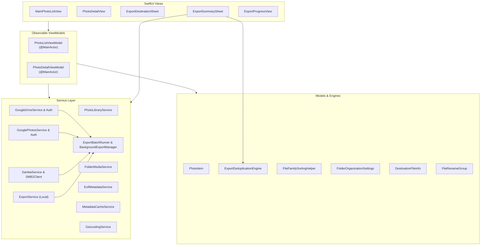
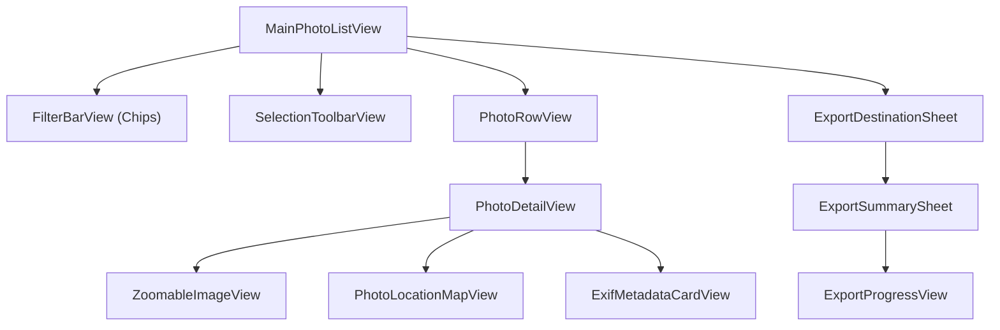

# Architecture & Design

This document details the architectural design, core subsystems, data models, and services of **Photo Exporter**.

---

## 1. Architectural Overview

The application follows the **MVVM (Model-View-ViewModel)** architectural pattern with modern Swift concurrency (`async/await`, structured concurrency, actors, and Combine for reactive state binding):

---

## 2. Service Layer Breakdown

### 2.1 `PhotoLibraryService` ([PhotoLibraryService.swift](./Photo%20Exporter/Services/PhotoLibraryService.swift))
- **Responsibilities**: PhotoKit interface for querying, reading, rotating, deleting, and batch-processing photos and videos.
- **Resource Loading**: Accesses underlying original assets via `PHAssetResource` (`.photo`, `.video`, `.fullSizePhoto`, `.fullSizeVideo`) to read raw bitstreams without baking in Photos app rendering.
- **Photos App Adjustments**: Parses the internal Photos app adjustment data (`com.apple.photo` payload in `PHAdjustmentData`) to detect whether date/time, GPS coordinates, rotations, filters, or depth effects were modified in Photos.app.
- **Inferred Timezone Engine**: Analyzes sequences of photos without native timezone offsets (e.g. from cameras without GPS) and infers their timezones based on surrounding photos, location coordinates, or device timezone.

### 2.2 `FolderMediaService` ([FolderMediaService.swift](./Photo%20Exporter/Services/FolderMediaService.swift))
- **Responsibilities**: Unified folder browsing, header-only metadata extraction, thumbnail generation/caching, detail loading, and in-place rename, rotation, deletion, and metadata application across Local Folders, Google Drive, and Samba shares (`MediaSource`).
- **Security-Scoped Access**: Uses `LocalFolderAccess` to hold security-scoped access on the root bookmarked URL while browsing nested subdirectories.

### 2.3 `ExifMetadataService` ([ExifMetadataService.swift](./Photo%20Exporter/Services/ExifMetadataService.swift))
- **Responsibilities**: Extracts raw EXIF, TIFF, GPS, IPTC, XMP, and QuickTime user data (including binary TIFF/Exif SubIFD fallback for RAW/DNG `OffsetTime*` and GPS tags); injects adjusted metadata during export.
- **Lossless Metadata Injection (`tryLosslessEmbedAdjustedMetadata`)**:
  - Uses `CGImageDestinationCopyImageSource` with `CGImageMetadata`.
  - Directly updates header markers (EXIF `0x9003`, `0x9004`, `0x9010`, `0x9011`, TIFF `0x0132`, GPS tags) without decompressing DCT blocks or recompressing pixel data.
  - Injects explicit `exif:DateTimeOriginal` / `exif:DateTimeDigitized` XMP tags for PNG files on physical iOS devices.
  - Fallback: `fallbackEmbedAdjustedMetadata` using `CGImageDestinationAddImageFromSource` for unsupported legacy formats.
- **Video Metadata**: Writes QuickTime user data atom `com.apple.quicktime.creationdate` using `AVAssetExportSession` with `AVMetadataItem` and ISO-8601 formatting.

### 2.4 `ExportService`, `ExportBatchRunner` & `BackgroundExportManager` ([ExportService.swift](./Photo%20Exporter/Services/ExportService.swift), [ExportBatchRunner.swift](./Photo%20Exporter/Services/ExportBatchRunner.swift), [BackgroundExportManager.swift](./Photo%20Exporter/Services/BackgroundExportManager.swift))
- **Responsibilities**: `ExportService` handles local iOS filesystem exports via Security-Scoped Bookmarks (`UIDocumentPickerViewController`).
- **Batch Execution & Retry**: `ExportBatchRunner` centralizes media preparation, byte-level download/upload progress (`DownloadProgressDelegate`, `UploadProgressDelegate`), and transient failure retries across destinations.
- **Background Continuation**: `BackgroundExportManager` registers and submits `BGContinuedProcessingTaskRequest` using `$(PRODUCT_BUNDLE_IDENTIFIER).export.active` so exports continue seamlessly when backgrounded.

### 2.5 `GoogleDriveService`, `GoogleDriveAuthService` & `GoogleOAuthConfig` ([GoogleDriveService.swift](./Photo%20Exporter/Services/GoogleDriveService.swift), [GoogleDriveAuthService.swift](./Photo%20Exporter/Services/GoogleDriveAuthService.swift), [GoogleOAuthConfig.swift](./Photo%20Exporter/Utilities/GoogleOAuthConfig.swift))
- **OAuth Configuration**: `GoogleOAuthConfig` reads `CLIENT_ID` and `REVERSED_CLIENT_ID` at runtime from `GoogleService-Info.plist`.
- **Resilient Networking**: Short API and token-refresh requests run on `GoogleDriveAuthService`'s connectivity-aware `apiSession` via `performResilientDataRequest`, flushing idle keep-alive sockets on `UIApplication.willEnterForegroundNotification` and retrying transient post-background errors.
- **Uploads & Streaming**: Supports `uploadType=resumable` binary streaming (`uploadSession`), authenticated thumbnail loading (`Authorization: Bearer <token>`), recursive subfolder hierarchy creation, and HTTP Range video streaming (`streamingSession`, `GoogleDriveRangeStreamDelegate`, `GoogleDriveRangeCache`).

### 2.6 `GooglePhotosService` & `GooglePhotosAuthService` ([GooglePhotosService.swift](./Photo%20Exporter/Services/GooglePhotosService.swift), [GooglePhotosAuthService.swift](./Photo%20Exporter/Services/GooglePhotosAuthService.swift))
- **Responsibilities**: Shares `GoogleOAuthConfig` for `ASWebAuthenticationSession` sign-in, uploads media bytes to Google Photos upload endpoints, and invokes `mediaItems:batchCreate`.
- **Behavior**: Direct uploads without conflict checks or date-based subfolders (Google Photos is a flat timeline).

### 2.7 `SambaService` & `SMB2Client` ([SambaService.swift](./Photo%20Exporter/Services/SambaService.swift), [SMB2Client.swift](./Photo%20Exporter/Services/SMB2Client.swift))
- **Responsibilities**: Pure Swift SMB2/3 network client implemented directly over BSD sockets (`CFStream` / POSIX `send`/`recv`).
- **Features**:
  - SMB2 Negotiate, Session Setup (NTLMSSP authentication), Tree Connect, Create, Write, Read, Delete, Close.
  - Safe recursive directory creation (`createDirectoryTree`).
  - Per-subfolder file set caching (`subfolderFileSets`) to avoid incorrect duplicate renaming against root share files.

### 2.8 `MetadataCacheService` ([MetadataCacheService.swift](./Photo%20Exporter/Services/MetadataCacheService.swift))
- **Responsibilities**: Disk-persisted JSON metadata and media list caches in `Application Support`, plus persisted export recovery state (`PersistedExportErrorState`) for resuming/retrying failed exports across restarts.
- **Startup Storage Sweep (`performStartupStorageSweep`)**: Launched at app startup from `Photo_ExporterApp.init()` to remove orphaned files in `FileManager.default.temporaryDirectory`, clean obsolete debug artifacts, and expire `FolderCaches/` files unused for more than 30 days (`cacheTTL`), while preserving the Photo Library root caches.

---

## 3. Core Domain Models & Algorithms

### 3.1 Deduplication Engine (`ExportDeduplicationEngine`)
Defined in [`DestinationFileInfo.swift`](./Photo%20Exporter/Models/DestinationFileInfo.swift):
- **Suffix Normalization (`strippingDedupSuffix`)**:
  - Regular expression: `#"^(.*?)(?:-(\d+)|\s*\(\d+\))$"#`
  - Strips sequential suffixes: `-1`, `-2`, ` (1)`, ` (2)`.
  - Recursively reduces multi-collision names (e.g. `img (1)-2.jpg` $\rightarrow$ `img.jpg`).
- **Duplicate Evaluation (`evaluateDuplicates`)**:
  - Files are considered identical duplicates and skipped if:
    1. Base filename (after stripping dedup suffix) matches case-insensitively.
    2. Modification timestamp matches within a 2.0-second tolerance.
    3. File size in bytes matches exactly.

### 3.2 Family-Based Conflict Resolution (`resolveFilenameConflicts`)
Defined in [`FileRenameItem.swift`](./Photo%20Exporter/Models/FileRenameItem.swift):
- **Family Identification**: Files sharing the same root base name (`img.jpg`, `img-1.jpg`, `img-2.jpg`, etc.) belong to the same family.
- **Natural Sorter (`FileFamilySortingHelper`)**:
  - Sorts root/unsuffixed file first (`img.jpg`), followed by numerical suffix order (`img-1.jpg`, `img-2.jpg`, `img-10.jpg`).
- **Conflict Grouping**:
  - If any file in the family requires renaming, the group displays:
    1. All destination files in the family (`[Destination]` badge).
    2. All unrenamed batch items in the family (`[Original]` badge).
    3. All renamed batch items (`[Renamed]` badge with arrow `old → new`).

### 3.3 Folder Organization Engine (`FolderOrganizationSettings`)
Defined in [`FolderOrganizationSettings.swift`](./Photo%20Exporter/Models/FolderOrganizationSettings.swift):
- **Token Replacement**: Case-sensitive replacement for:
  - `yyyy`: 4-digit Gregorian year (e.g. `2026`)
  - `yy`: 2-digit year (e.g. `26`)
  - `MM`: 2-digit month (e.g. `11`)
  - `dd`: 2-digit day (e.g. `07`)
- **Literal Text**: Custom text like `photosyyyy/MM` or `yyyy-MM` is preserved verbatim. Other casings (`YYYY`, `mm`) remain literal.
- **Validation**: Checks against illegal filesystem characters (`?`, `*`, `|`, `<`, `>`, `:`, `"`) and rejects persisting invalid patterns to `UserDefaults`.

---

## 4. UI Architecture & View Hierarchy

### 4.1 View Hierarchy Overview

### 4.2 Views Summary
1. **`MainPhotoListView`**: Root view with lazy loading grid/list, chronological sort toggle, `MediaSourceSheet` switcher, `FolderPathBarView` breadcrumbs, `FilterBarView` chips, `SelectionToolbarView`, `FloatingProgressBannerView`, and batch actions (`BatchEditDateTimeSheet`, `ApplyChangesSummarySheet`, `ExportProcessingInfoSheet`).
2. **`PhotoDetailView`**: Interactive detail inspector with horizontal swipe navigation (`DetailMediaSlideView`), `ZoomableImageView`, `DetailVideoPlayer` hosting `AVPlayerViewController`, single-step expand-and-rotate fullscreen transition, `AdjustDateTimeSheet`, `PhotoLocationMapView`, and `ExifMetadataCardView`.
3. **`ExportDestinationSheet`**: Destination picker (Local, `GoogleDriveConfigurationSheet`, Google Photos, `SambaConfigurationSheet`, `RemoteFolderSelectionSheet`, `FolderPicker`) with folder organization toggle and pattern picker.
4. **`ExportSummarySheet`**: Pre-export conflict sheet showing skipped duplicate files, family rename cards, and background destination thumbnails.
5. **`ExportProgressView`**: Progress modal with circular indicator, current item thumbnail, elapsed time, cancellation controls, retry recovery, and keep-screen-awake support.

---

## 5. Build Configuration & OAuth Externalization

- **[Config.xcconfig](./Config.xcconfig)** defines public-safe default build settings (`DEVELOPMENT_TEAM` unset, `PRODUCT_BUNDLE_IDENTIFIER = com.example.Photo-Exporter`) and optionally includes a gitignored `Local.xcconfig` (`#include? "Local.xcconfig"`).
- **[Info.plist](./Info.plist)** parameterizes `BGTaskSchedulerPermittedIdentifiers` via `$(PRODUCT_BUNDLE_IDENTIFIER).export.*`.
- **`GoogleOAuthConfig`** loads iOS OAuth settings from an untracked `Photo Exporter/GoogleService-Info.plist` created from [GoogleService-Info.plist.example](./GoogleService-Info.plist.example).

